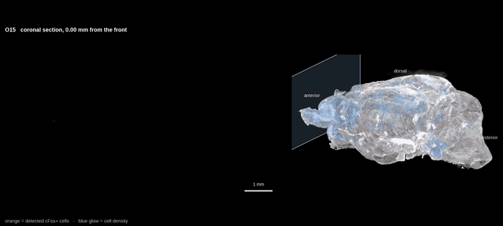
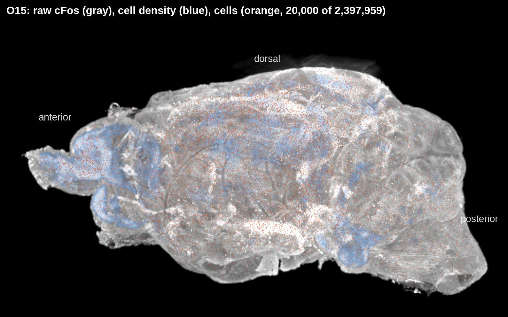
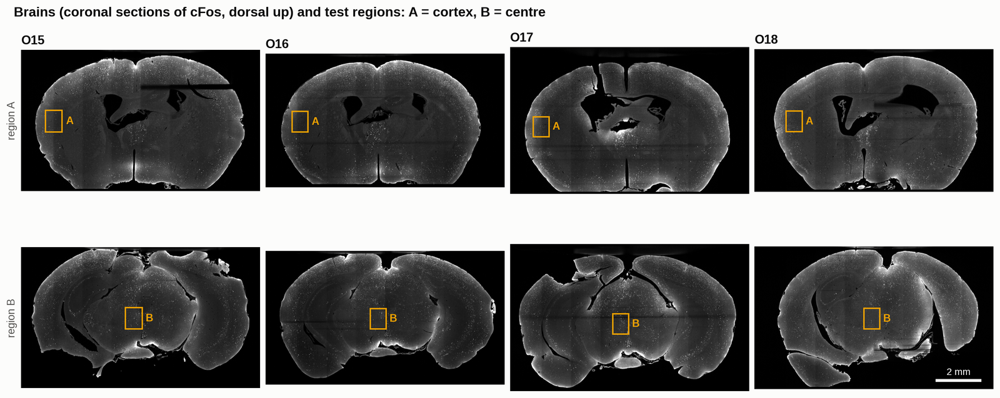
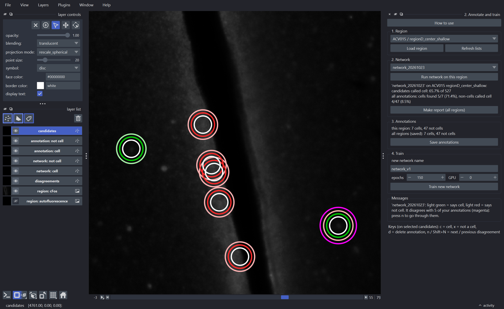
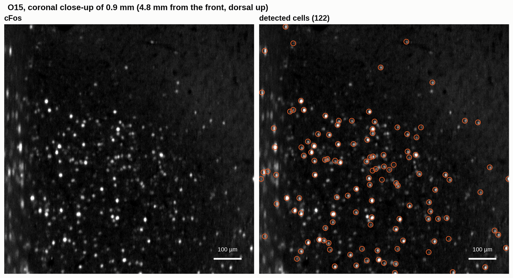
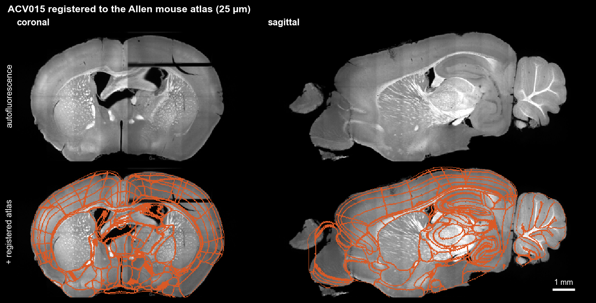
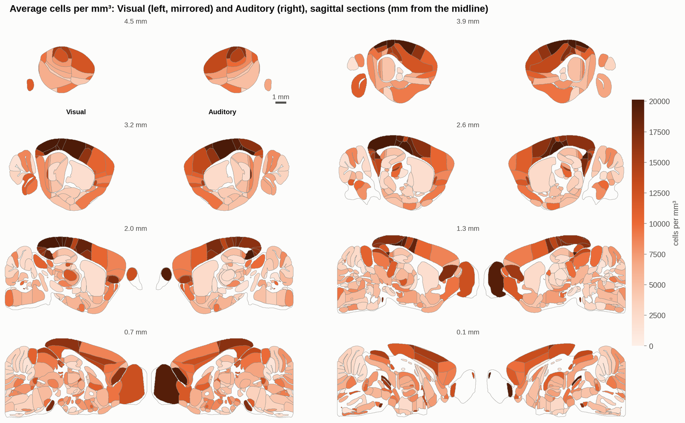

# cfos-mapper

Find cFos+ cells in whole cleared mouse brains imaged with a light-sheet
microscope, and count them in every region of the Allen mouse brain atlas.

<p align="center">
  
  <br><sub>From front to back through a whole brain: the coronal section with its detected cells (orange, left)
  and where it lies in the 3D brain (right).</sub>
</p>

It puts together three [BrainGlobe](https://brainglobe.info) tools and keeps
every step simple:

| step | what happens | tool |
|---|---|---|
| 1. candidates | bright, cell-sized spots in the cFos channel | cellfinder (detection) |
| 2. annotation | you mark a few hundred candidates as *cell* / *not a cell* in small test regions | napari plugin |
| 3. training | a network learns your annotations (starting from cellfinder's pretrained one) | cellfinder (training) |
| 4. whole brain | every candidate of a whole brain is classified → cells, density map | cellfinder (classification) |
| 5. registration | the brain is matched to the atlas (autofluorescence channel) | brainreg |
| 6. regions | every cell gets its atlas region → cells and cells/mm³ per region, all brains in one table | brainglobe |

Images are read and written as OME-Zarr with [pymif](https://github.com/embl-mif/pymif).

You can use it in three ways, all doing exactly the same:

- **napari plugin**: four widgets for drawing test regions, annotating and training, looking at
  whole-brain results, and the atlas regions
- **command line**: `cfos-mapper <step>`, also in a Docker container on an HPC cluster
- **Python**: `import cfos_mapper as cf`, plain functions on one brain at a time

## What it looks like

**A whole brain.** One cleared brain in 3D: the cFos signal (gray), the cell density (blue) and a sample of
its 2.4 million detected cells (orange).



**Test regions.** A few small boxes per brain, in different parts of the brain, where candidates are annotated
by hand.



**Annotation and training.** In napari every candidate of a test region gets rings: solid green = you said cell,
solid red = not a cell, light green / red = what the network says, magenta = you and the network disagree.



**Cells in the whole brain.** The trained network classifies every candidate of the brain.



**Registration.** The autofluorescence is matched to the Allen atlas (brainreg); every cell then gets its atlas
region.



**Quantification.** Cells per mm³ in every atlas region, for every mouse, and the average of groups of mice
side by side on the atlas ([`region_figures.ipynb`](examples/figures/region_figures.ipynb)).



## Install

You need Python ≥ 3.11 and, for training and whole brains, an NVIDIA GPU.

```bash
# with the napari plugin (desktop / workstation)
pip install "cfos-mapper[napari] @ git+https://github.com/embl-mif/cfos-mapper.git"

# without any GUI: Python API + command line only (servers, HPC, Docker)
pip install "cfos-mapper @ git+https://github.com/embl-mif/cfos-mapper.git"
```

From a local copy: `pip install ".[napari]"` or `pip install .` (or `pip install ".[hpc]"`, the same).
For development: `pip install -e ".[dev]"` and run `pytest`.

> **GPUs.** torch is kept below 2.10 because newer versions dropped the V100 (sm_70) GPUs.
> If cellfinder complains about tensorflow, set `KERAS_BACKEND=torch` (cfos-mapper does this itself
> when it is imported).

## A project: settings.json and regions.json

Everything about a project lives in one settings file:

```bash
cfos-mapper init my_project        # writes my_project/settings.json and my_project/regions.json
```

Edit `brains_folder` (one `<brain>.ome.zarr` per brain, with a cFos and an autofluorescence channel)
and `results_folder`. The other entries are the parameters of every step, with values that worked on
our data (3 × 1.46 × 1.46 µm voxels). `regions.json` holds the test regions; you normally draw them in
napari.

Commands find the settings file in this order: `--settings FILE`, the environment variable
`CFOS_MAPPER_SETTINGS`, `./settings.json`.

Everything the steps write goes next to the results folder:

```
project/
  results/<brain>/test_regions/   test regions: image, candidates, your annotations, network calls
  results/<brain>/full_brain/<network>/   cells.csv, all_candidates.csv, cells_density.ome.zarr, regions/
  results/<brain>/registration/   brainreg output (atlas on the brain, deformation fields)
  networks/<network>/             trained networks, their test results
  reports/<network>/              network reports, cells per region of all brains
  atlases/                        downloaded atlases
  logs/                           logs of the jobs started from napari
```

## Command line

```bash
export CFOS_MAPPER_SETTINGS=my_project/settings.json

cfos-mapper napari                                   # open napari with the four widgets
cfos-mapper prepare O15 regionA_cortex               # cut a test region, find its candidates
cfos-mapper prepare-all                              # ... all test regions not prepared yet
cfos-mapper predict O15 regionA_cortex pretrained    # a network's calls on a test region
cfos-mapper predict-all network_v3                   # ... on every test region
cfos-mapper train network_v3 --epochs 150 --gpu 1    # train on all saved annotations
cfos-mapper run-brain O15 --network network_v3 --gpu 0              # whole brain
cfos-mapper run-brain O15 --network network_v3 --planes 900 1000    # quick test on 100 planes
cfos-mapper register O15                             # brainreg (CPU, ~30-60 min)
cfos-mapper count O15 --network network_v3           # cells per atlas region
cfos-mapper summary --network network_v3             # all brains in one table
```

`cfos-mapper <step> --help` explains every option. Whole brains need a lot of memory: about
2 × the size of one channel (~550 GB for our brains).

## napari plugin

```bash
cfos-mapper napari --settings my_project/settings.json
```

| widget | for |
|---|---|
| **1. Training regions** | load a brain, see the saved test regions, draw new ones (rectangles in two views) |
| **2. Annotate and train** | annotate candidates (keys `c` cell, `x` not a cell, `d` delete, `n` / `Shift+N` next / previous disagreement), run a network, statistics, reports, train a new network |
| **3. Whole-brain results** | the brain, the network's calls and the cell density of a whole-brain run |
| **4. Atlas regions** | register the brain, check the atlas outlines on it, count cells per region, density per region |

Every candidate is drawn as concentric rings: white = candidate, solid green / red = your annotation,
light green / red = the network, magenta = you and the network disagree. *How to use* in widget 2
opens the full instructions.

Anything that uses the GPU (finding candidates, running or training networks) or takes long
(registration) runs as a separate `cfos-mapper` process, so napari never freezes or crashes. The
result appears when it is done, and the log goes to `logs/`.

## Python

```python
import cfos_mapper as cf

settings = cf.load_settings("my_project/settings.json")

# a test region and its candidates
signal, background, voxel_size, candidates = cf.prepare_region("O15", "regionA_cortex", settings)

# what a network says, and how good it is against your annotations
predictions = cf.get_predictions("O15", "regionA_cortex", "network_v3", settings)
annotations = cf.load_annotations(cf.annotations_file("O15", "regionA_cortex", settings))
print(cf.prediction_statistics(predictions["calls"], annotations))

# whole brain, registration, cells per region
cf.run_brain("O15", "network_v3", settings)
cf.register_brain("O15", settings)
table = cf.count_cells_per_region("O15", "network_v3", settings)
table[table.acronym == "Isocortex"]
```

The functions are small and documented; `help(cf.find_candidates)` etc.

## Examples

Jupyter notebooks in [`examples/`](examples):

| notebook | shows |
|---|---|
| [`01_command_line.ipynb`](examples/01_command_line.ipynb) | a whole analysis with `cfos-mapper` commands, and on an HPC cluster with the container |
| [`02_python_api.ipynb`](examples/02_python_api.ipynb) | the same steps as Python functions, with plots |
| [`03_napari_plugin.ipynb`](examples/03_napari_plugin.ipynb) | opening the plugin, a guided tour of the four widgets |
| [`run_all_brains.py`](examples/run_all_brains.py) | the whole analysis of every brain of a project on one workstation (run-brain → register → count, then summary), skipping what is done |
| [`figures/`](examples/figures) | the figure notebooks of our analysis (results, method, pretrained network test, cell density per region and group) |

## Atlas and left / right

Registration uses the autofluorescence channel and the atlas in `settings.json` (`atlas.name`,
default `allen_mouse_25um`). `atlas.orientation` tells brainreg how the images lie, in
[brainglobe letters](https://brainglobe.info/documentation/setting-up/image-definition.html):
where axis 0, 1 and 2 start. Ours is `sal`: plane 0 is dorsal (superior), y runs from anterior,
x from the animal's left. To register one brain with another orientation, use
`cfos-mapper register O15 --orientation sar` or the orientation box of widget 4 in napari
(hover over it for what the letters mean). *Show the brain* there shows the brain with its axes
and writes on the canvas what the letters in the box mean for it, so you can pick them by eye.
The widget also shows the orientation each brain was registered with, and writes it on the canvas
with the atlas layers.

Registration cannot check the last letter. The brain is nearly mirror-symmetric, so a mirrored
image registers just as well. A wrong `l`/`r` only swaps the *left* and *right* columns of the
tables; the regions and the counts stay right. Check it once with something you know is on one
side, for example an injection, a lesion or a cut mark.

Check every registration in widget 4 (*Show atlas on the brain*): the outlines should follow the
brain.

## Docker / HPC

Every version tag builds a Docker image with the GPU-ready, no-GUI install
(`ghcr.io/embl-mif/cfos-mapper:<version>`, and `:latest` for the newest version). On a cluster with
Apptainer / Singularity:

```bash
apptainer pull cfos-mapper.sif docker://ghcr.io/embl-mif/cfos-mapper:0.1.0
apptainer exec --nv --bind /path/to/data cfos-mapper.sif \
    cfos-mapper --settings /path/to/data/settings.json run-brain O15 --network network_v3
```

`--nv` gives the container the GPU, and `--bind` the data folder. Locally:
`docker run --gpus all -v /data:/data ghcr.io/embl-mif/cfos-mapper:0.1.0 --settings /data/settings.json register O15`.

## Versions

The version comes from git tags (setuptools-scm): tag a commit `v0.2.0` and push the tag. GitHub
Actions then runs the tests, builds the package, makes a GitHub release and pushes the Docker image
`ghcr.io/embl-mif/cfos-mapper:0.2.0`. Commits between tags get versions like `0.2.1.dev3+g1a2b3c4`.

## License

BSD 3-Clause, like cellfinder and brainreg.
